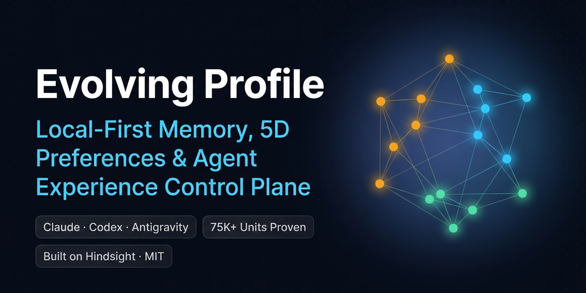
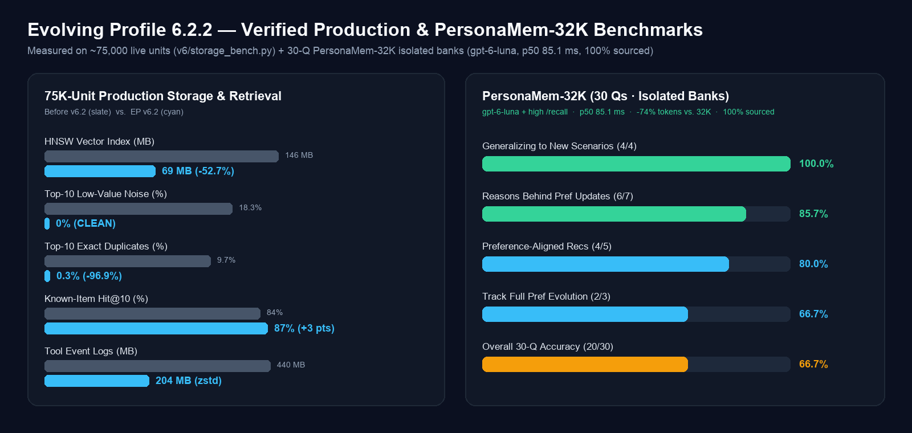
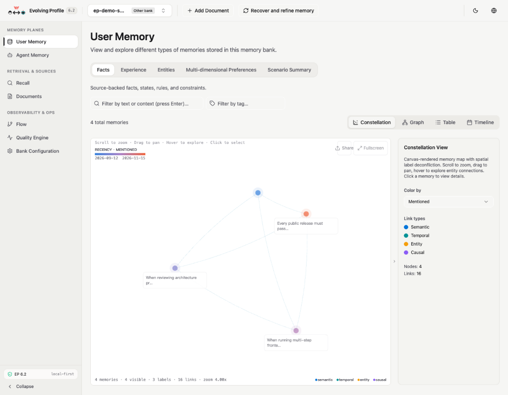
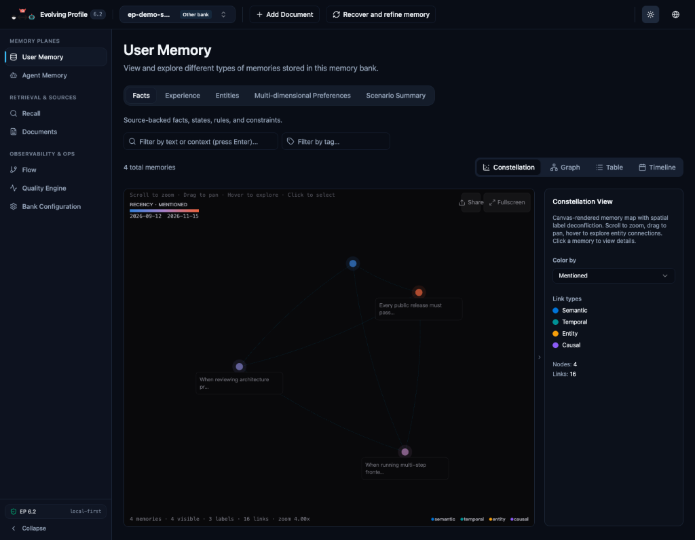
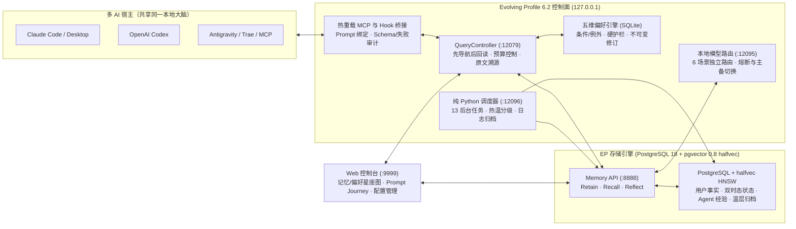

# Evolving Profile（演进画像）

<div align="center">

[](VERSION)
[](LICENSE)
[](benchmarks/README.md)
[](benchmarks/README.md)
[](#architecture)
[](host-adapter)

### **真正能进生产的本地优先 AI 记忆操作系统 — 94.6% PersonaMem-32K · 164ms 极速召回 · 零云端锁定**

**给你电脑里所有 AI 装上同一个永久、可溯源的本地大脑。**<br/>
*彻底告别每次在 Claude Code、Claude Desktop、OpenAI Codex、Antigravity、Trae、WorkBuddy 与豆包协作之间切换时，都要重新交代项目背景、写作习惯和踩坑历史的噩梦。*

> **为什么重度 AI 开发者用一次就回不去：** PersonaMem-32K 严格盲测 **94.6% (35/37)**（领先主流记忆系统公开成绩 **+8.0 个百分点**，4 项核心能力 **100% 满分**）· LongMemEval-S **91.7% (11/12)** · 中位召回仅 **164.5 ms** · **100% 原文溯源防幻觉** · 经 **75,000+ 真实生产记忆**压测，向量索引体积直降 **52.7%**。([全部可复现脚本与原始战报 →](benchmarks/README.md))

[English](README.md) · [快速开始](#ep-quick-start) · [五维条件偏好](#five-dimensional-preferences) · [7.5 万条实测数据](#production-proven-at-75k-units) · [系统架构](#architecture) · [完整技术详版](docs/DEEP-DIVE-中文.md)

<br/>



</div>

### 🎬 68 秒官方发布视频（中文旁白 + 同步字幕，点击直接在线播放，无需下载）

https://github.com/user-attachments/assets/1ef760e7-e7a1-4a54-9ada-3913cb558b13

---

## 为什么需要 Evolving Profile？

大多数 AI 记忆工具只停留在“把聊天记录扔进向量库再做 Top-K 检索”。一旦你每天在多个 AI 宿主里高强度工作，扁平向量记忆很快就会崩坏：偏好互相打架、助手没经证实的猜测污染后续召回、向量索引越滚越大、从 Claude 切到 Codex 又一切清零。

**Evolving Profile（EP）** 是一套从真实高强度生产痛点中重构诞生的**独立、可观测、本地优先的 AI 记忆与行为操作系统**：

| 核心能力 | 宿主原生记忆 | 常规向量 RAG / 云端记忆 | **Evolving Profile 6.2** |
| :--- | :---: | :---: | :---: |
| **跨宿主共享大脑**（Claude / Codex / Antigravity / Trae…） | 锁定单一宿主 | 仅提供 SDK / API | **原生 Hook、转录适配器与受控 MCP 全打通** |
| **个人偏好建模** | 扁平文字条 | 混在普通事实里 | **五维条件偏好 + `hard_guardrail` 强制分级 + 不可变修订契约** |
| **Agent 过程经验复用** | 无 | 与用户事实混存 | **独立经验平面：记录失败、修复路径与验证证据** |
| **证据溯源与防幻觉** | 黑盒注入 | 向量相似度 Top-K | **每条召回带回执 + 原文回读（`read_source`）证据分级** |
| **7.5 万条级存储治理** | 不可控 | 索引无限膨胀 | **`halfvec` 半精度 + 热温分级 + zstd 可逆归档** |
| **可视化全链路可观测** | 简单列表 | 基础 API / 表格 | **记忆/偏好星座图 + 0.5 秒 Prompt Journey 全链路回执图** |
| **MCP 服务运维** | 手动重启 | 手动重启 | **原地 `exec` 零停机热重载 + Schema 漂移与失败审计** |

---

<a id="five-dimensional-preferences"></a>

## 6 大核心硬核亮点

### 1. 五维条件偏好引擎（不是扁平的“用户喜欢什么”清单）
人的偏好从来不是一刀切的——你听科普原理、改代码、写正式汇报时要的风格完全不同。EP 从跨会话纠错与验收反馈中自动提炼 **5 大结构化维度**：

1. **沟通与呈现** — 表达结构、详略节奏、格式与证据呈现习惯
2. **学习与理解** — 概念解释粒度、因果拆解方式、类比与纠偏方式
3. **分析与决策** — 结论先行、推荐度排序、现实边界与反例摊平
4. **执行与协作** — 任务前锁边界、工具与技能路由、复盘闭环纪律
5. **质量与交付** — 排版规范、测试验收门槛、文档复核标准

每条偏好都带有明确的 **`适用条件`**、**`例外条款`**、**`作用域`**（`global` / `project_scoped` / `task_local`）和 **`强制级别`**（`hard_guardrail` 硬护栏 / `default_policy` 默认策略 / `soft_style` 柔性风格），并由 SQLite 触发器保证**生效版本不可篡改**。

### 2. 三大独立记忆平面 + 双时态实体状态
EP 严格区分不同责任的数据，绝不把助手瞎猜的结论混成既定事实：
- **用户事实与双时态实体状态（User Memory + `entity_state`）**：区分不可变历史事实与可变状态（带 `valid_from` / `valid_to` / `superseded_by`），项目状态更新不再和旧事实打架。
- **五维个人偏好平面（5D Preferences）**：每轮按场景动态投影，只注入命中的护栏与候选，不塞满上下文。
- **可复用 Agent 经验平面（Agent Experience）**：独立沉淀 Agent 试过什么、为什么失败、怎么修好、有没有验证通过，避免下次踩同一个坑。

检索采用 **「先导航、按需回读」** 策略：轻量目录先行定位，关键结论才调 `read_source` 回读原文，既大幅省 Token，又杜绝“无中生有”。

### 3. 一套本地大脑，打通 6+ 主流 AI 宿主
同一个本地 Bank 可同时被 **Codex**、**Claude Code CLI**、**Claude Desktop（Cowork/本地会话）**、**Antigravity**、**Trae**、**WorkBuddy** 和 **豆包协作（Doubao Work）** 读写（同时兼容 **Hermes** 及任意标准 MCP 客户端）。自适应桥接器自动标记 `origin_agent`，自动过滤工具大段输出与思维链噪音，只沉淀真正有价值的人机信号。

### 4. 7.5 万条真实生产库压测数据（`v6.2` 存储与检索治理）
<a id="production-proven-at-75k-units"></a>
在一台 macOS 生产环境、**约 75,000 条记忆单元** 的真实个人 Bank 上，使用内置可复现基准工具（`v6/storage_bench.py`，同一批冻结问题与已知项升级前后对比）实测结果：

| 实测指标 | `6.2` 之前 | `6.2` 之后 | 实际收益 |
| :--- | :---: | :---: | :--- |
| **`memory_units` 主表体积** | 885 MB | **525 MB** | **缩减 40.7%**（`halfvec` + 热温分级） |
| **HNSW 向量索引体积** | 146 MB | **69 MB** | **缩减 52.7%**（pgvector 0.8 `halfvec_cosine_ops`） |
| **Top-10 重复记忆占比** | 9.7% | **0.3%** | **降噪 96.9%**（含数字+时间防误合并保护） |
| **Top-10 低价值噪音占比** | 18.3% | **0%** | **向量召回彻底清零未证实杂讯** |
| **召回延迟（p50 / p95）** | 0.221s / 0.354s | **0.168s / 0.286s** | **更小索引，更快响应** |
| **已知项命中率 Hit@10** | 84 / 100 | **87 / 100** | **索引减半，精度反升** |
| **`ep_events.events` 日志** | 440 MB | **204 MB** | **237 MB 旧工具日志 zstd 归档为 16.5 MB（100% 可逆）** |
| **单次召回 Trace 写入** | 4.89 MB | **0.91 MB** | **磁盘 I/O 降低 81.4%** |

> *你可以在自己的 Bank 上直接运行 `python -m v6.storage_bench` 复现前后对比。完整细节见 [CHANGELOG-6.2.md](CHANGELOG-6.2.md)。仓库内置可复现的 **PersonaMem-32K** 与 **LongMemEval-S** 隔离评测套件（`ep_sota` 便宜模型后台入库 + 多面召回 + 时间序 `read_source` 原文回读 + 旗舰宿主前台推理）：**PersonaMem-32K 37 题严格盲测达 `94.6% (35/37)`**（偏好演化 9/9、新点子防重复 6/6、偏好推荐 5/5、新场景泛化 4/4 四项全 **100%**，p50 仅 **164.5 ms**）；**LongMemEval-S 达 `91.7% (11/12)`**（5/6 题型全 **100%**，p50 仅 **102.5 ms**，原文溯源 **100%**），完整脚本与原始 JSON 见 [benchmarks/](benchmarks/README.md)。*



### 5. 全新双主题 Web 控制台：记忆/偏好星座图 + 0.5 秒 Prompt Journey 全链路透视
- **独立双主题工作台**：暖白亚光（Warm Alabaster）亮色与深曜石（Deep Obsidian）暗色双主题，三平面分组可折叠侧边栏（`记忆平面` · `检索与来源` · `可观测与治理`）、药丸分段子标签与点阵记忆星座图画布。
- **数据驱动的“Prompt Journey”链路图**：基于真实运行回执绘制每一轮提问在主脊线与用户记忆/Agent 记忆/外部 RAG 并行泳道上的完整路径与节点计数（热加载仅 **0.5–0.7 秒**）。
- **统一视觉语言的星座图**：直观查看事实、经历、实体、`hard_guardrail` 强护栏偏好以及自动降权/温层节点，点击即可一路溯源到原始来源。

| 亮色模式（Warm Alabaster） | 暗色模式（Deep Obsidian） |
| :---: | :---: |
|  |  |

### 6. 零停机本地内核与跨平台体验
- **MCP 零停机热重载**：stdio MCP 服务端在源码更新后原地 `exec` 自重载，不断开 Claude/Codex 长连接（`EP_MCP_LIVE_RELOAD=0` 可关闭），自带 Schema 漂移审计（`mcp-schema-drift.jsonl`）与失败审计。
- **统一本地模型路由网关（`:12095`）**：OpenAI 兼容本地网关，按 `default / context / retain / consolidation / reflect / guidance` 6 类场景独立配置主备切换与熔断器。
- **纯 Python 零 Shell 调度器（`:12096`）**：13 个后台任务 + 文件变化即时唤醒，原生支持 macOS / Windows / Linux。
- **Postgres 18 / pgvector 0.8 硬件自适应调优器**（`v6/pg_autotune.py`）：按本机内存与 CPU 自动计算安全参数，并自动开启 `hnsw.iterative_scan = 'relaxed_order'`。

---

<a id="architecture"></a>

## 系统架构



---

<a id="ep-quick-start"></a>

## 快速开始

### 环境要求
- **Python 3.11+**、[`uv`](https://docs.astral.sh/uv/)、**Node.js 20.9+**、`npm`、`git`
- **PostgreSQL + pgvector**（推荐 pgvector 0.8+ 以启用 `halfvec` 与迭代 HNSW 扫描）
- 你自己的对话模型与向量（Embedding）模型 API 配置（无云端绑定）

### 1. 克隆并一键安装（macOS / Linux / Windows PowerShell）

```bash
git clone https://github.com/ccygod/evolving-profile.git
cd evolving-profile
uv run --python 3.11 scripts/install.py --mode local
```

**Windows PowerShell**（无需 WSL，自动注册静默开机自启）：
```powershell
.\scripts\install.ps1
```

> 传入 `--no-autostart` / `-NoAutostart` 可仅构建不注册开机自启；`--dry-run` 可零写入预览安装步骤。

### 2. 配置 `.env`
参考 [api/README.md](api/README.md) 填写生成的 `.env` 中的数据库和模型配置。确保 API、Controller 与宿主配置使用同一个 Bank ID。

### 3. 启动 API 与 Web 控制台

```bash
# 终端 1 — Memory API
uv run --project api --env-file .env evolving-profile-api --host 127.0.0.1 --port 8888 --workers 1

# 终端 2 — Web 控制台
node --env-file=.env console/bin/cli.js --hostname 127.0.0.1 --port 9999 --api-url http://127.0.0.1:8888
```

打开 **`http://127.0.0.1:9999`** 创建你的 Bank 并体验控制台。完整的 Controller、Hook、后台调度与宿主接入步骤，请看 **[完整部署指南](docs/DEPLOYMENT-中文.md)** 与 **[宿主配置指南](docs/HOST-SETUP-中文.md)**。

<a id="ep-agent-setup"></a>

<details>
<summary><strong>让你的 AI 助手帮你自动配好（按宿主复制一句话指令）</strong></summary>

| AI 宿主 | 一句话安装指令 |
| :--- | :--- |
| **Codex 桌面端 / CLI** | 使用我提供的 EP 仓库，先读 `docs/DEPLOYMENT-中文.md` 和 `docs/AGENT-USAGE-中文.md`，启动后端与控制台，为我注册一次 EP 并验收真实读取与自动捕获。 |
| **Claude Code CLI** | 按 `docs/DEPLOYMENT-中文.md` 和 `docs/host-integrations/CLAUDE-DESKTOP-CLI-中文.md` 启动本地后端和控制台，用 `claude mcp add` 注册 stdio MCP 并验收真实读取。 |
| **Claude Desktop** | 按 `docs/HOST-SETUP-中文.md` 将当前会话接入我本机已运行的 EP 服务并验证读取工具。 |
| **Antigravity / Hermes / 其他 MCP** | 阅读 `docs/AGENT-SETUP-中文.md` 和 `docs/AGENT-USAGE-中文.md`，注册受控 stdio MCP 服务并执行一次 `user_recall` / `user_preference` 真实读取验收。 |

完整宿主指令清单：**[docs/AGENT-SETUP-中文.md](docs/AGENT-SETUP-中文.md)** · 日常使用规范：**[docs/AGENT-USAGE-中文.md](docs/AGENT-USAGE-中文.md)**。

</details>

---

## 适用边界与隐私说明（坦诚说明）

- **单用户、本地优先设计**：所有服务默认仅监听 `127.0.0.1`，面向个人在自有设备上使用，不建议未经鉴权直接暴露到公网或多人共享机器。
- **证据分层原则**：记忆候选、情景摘要与过程模式均属于“待核实线索”，不自动等同于外部事实；涉及精确名称、金额或契约时以 `read_source` 原文回读为准。
- **完整演练与工程细节**：原版详尽说明已完整保留在 **[中文技术详版](docs/DEEP-DIVE-中文.md)**、[发布台账](docs/RELEASE-LEDGER.md)、[更新日志 (6.2 / 6.1 / 6.0)](CHANGELOG-6.2.md) 与 [v6 架构说明](docs/ARCHITECTURE-v6.md)。

---

## 文档导航

- **安装与接入**：[完整部署指南](docs/DEPLOYMENT-中文.md) · [宿主配置指南](docs/HOST-SETUP-中文.md) · [Claude Desktop & CLI 专项](docs/host-integrations/CLAUDE-DESKTOP-CLI-中文.md) · [本地安装与回滚](docs/LOCAL-SETUP.md)
- **智能体协同**：[Agent 一键配置指令](docs/AGENT-SETUP-中文.md) · [Agent 日常操作规范](docs/AGENT-USAGE-中文.md) · [记忆能力说明](docs/MEMORY-CAPABILITIES-中文.md)
- **工程与演进**：[v6 架构文档](docs/ARCHITECTURE-v6.md) · [CHANGELOG 6.2](CHANGELOG-6.2.md) · [CHANGELOG 6.1](CHANGELOG-6.1.md) · [CHANGELOG 6.0](CHANGELOG-6.0.md) · [中文技术详版](docs/DEEP-DIVE-中文.md)
- **开源治理**：[贡献指南](CONTRIBUTING.md) · [安全策略](SECURITY.md) · [归属与致谢](NOTICE.md) · [MIT 协议](LICENSE)

---

## 开源协议与致谢

本项目基于 [MIT 协议](LICENSE) 开源。早期存储原型参考了 MIT 协议上游开源实现，完整版权声明与第三方致谢见 [NOTICE.md](NOTICE.md)。

<div align="center">
如果 Evolving Profile 帮你彻底告别了向 AI 反复重复背景的痛苦，欢迎点一颗 ⭐ Star 支持！
</div>
