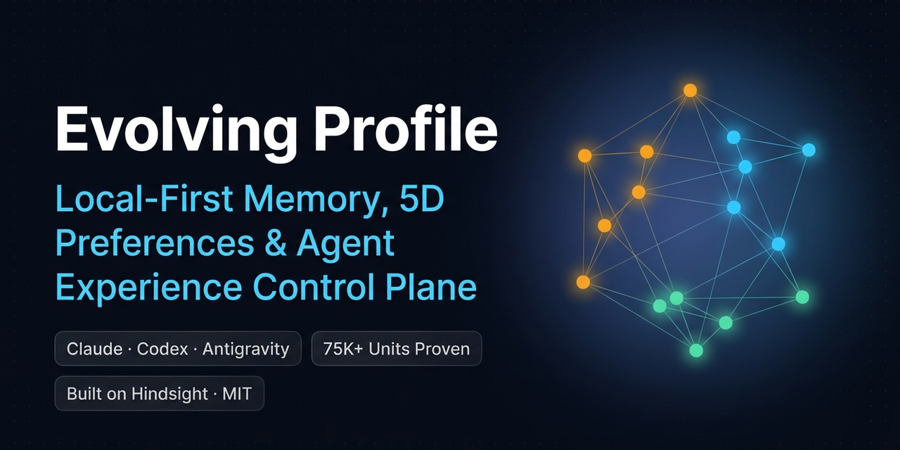
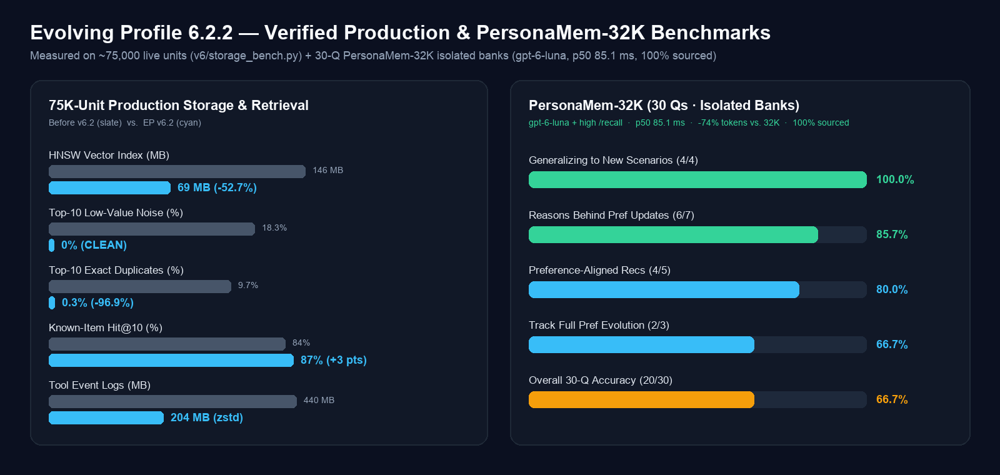
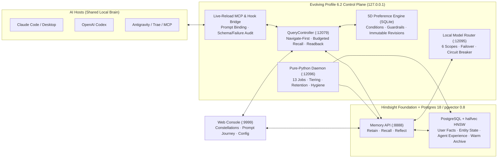

# Evolving Profile

<div align="center">

[](VERSION)
[](LICENSE)
[](api/pyproject.toml)
[](https://github.com/vectorize-io/hindsight)
[](host-adapter)

### **Local-First Memory, 5D Conditional Preferences & Agent Experience Control Plane**

**Stop re-explaining your projects, preferences, and past fixes every time you switch AI agents.**<br/>
*One local, source-audited brain shared across Claude Code, Claude Desktop, OpenAI Codex, Antigravity, Trae, WorkBuddy & Doubao Work.*

[简体中文](README-中文.md) · [Quick Start](#ep-quick-start) · [5D Preferences](#five-dimensional-preferences) · [75K Scale Benchmarks](#production-proven-at-75k-units) · [Architecture](#architecture) · [Deep Dive](docs/DEEP-DIVE.md)

<br/>



</div>

---

## Why Evolving Profile?

Most AI memory tools stop at dumping flat text snippets into a vector database. When you actually use AI coding and research agents every day across multiple hosts, flat memory breaks down fast: preferences contradict each other, unconfirmed assistant hallucinations pollute future recalls, vector indexes bloat, and switching from Claude to Codex means starting from scratch.

**Evolving Profile (EP)** is built on top of [Hindsight](https://github.com/vectorize-io/hindsight) and turns it into a **complete, observable, local-first memory operating system**:

| Capability | Native Host Memory | Vanilla Vector / Hindsight | **Evolving Profile 6.2** |
| :--- | :---: | :---: | :---: |
| **Cross-host shared memory** (Claude, Codex, Antigravity, Trae…) | Locked to 1 host | SDK / API only | **Native hooks, transcript adapters & MCP** |
| **User preferences** | Flat text notes | Unstructured facts | **5D conditional preferences + `hard_guardrail` enforcement + immutable revisions** |
| **Agent execution memory** | None | Mixed with user facts | **Dedicated plane: failures, repairs & verified strategies** |
| **Anti-hallucination / Evidence audit** | Black box | Vector top-k | **Source-linked receipts + original-source readback (`read_source`)** |
| **75K+ scale storage governance** | Opaque | Grows unbounded | **`halfvec` + hot/warm tiering + zstd tool-log archiving (100% reversible)** |
| **Visual observability** | Settings list | API / basic table | **Memory & Preference Constellations + 0.5s Prompt Journey link map** |
| **MCP server operations** | Manual restart | Manual restart | **In-place live code reload (`exec`) + schema-drift & failure audit** |

---

<a id="five-dimensional-preferences"></a>

## 6 Engineering Highlights

### 1. Five-Dimensional Conditional Preferences (Not a Flat "Likes" List)
Human preferences are conditional—how you want a quick bug fix explained is not how you want an executive report written. EP distills cross-session behavior and corrections into **5 structured dimensions**:

1. **Communication & Presentation** — structure, tone, formatting, evidence style
2. **Learning & Comprehension** — explanation depth, analogies, causal-first breakdowns
3. **Analysis & Decision-Making** — ranked recommendations, explicit trade-offs, boundary-first framing
4. **Execution & Collaboration** — pre-task scoping, verification gates, skill/tool routing
5. **Quality & Delivery** — review checklists, layout rules, regression acceptance

Every preference unit carries explicit **`conditions`**, **`exceptions`**, **`scope_level`** (`global` / `project_scoped` / `task_local`), and **`enforcement`** (`hard_guardrail` / `default_policy` / `soft_style`), backed by SQLite triggers enforcing **immutable active revisions**.

### 2. Three Memory Planes + Bi-Temporal Entity State
EP never mixes unverified guesses with confirmed facts or agent debugging logs:
- **User Memory Plane**: Long-term facts, experiences, observations, plus **bi-temporal `entity_state`** (`valid_from` / `valid_to` / `superseded_by`) so mutable project/service status never conflicts with immutable historical facts.
- **5D Preference Plane**: Active, reviewed, conditional collaboration rules projected per prompt.
- **Reusable Agent Experience Plane**: What the agent tried, why it failed, how it recovered, and whether recovery was verified.

Candidates are **navigated first** via a lightweight topic catalog and **expanded on demand** via `read_source`—cutting prompt token waste while keeping every claim traceable.

### 3. One Local Brain Across 6+ AI Hosts
One local Bank can be fed and queried simultaneously by **Codex**, **Claude Code CLI**, **Claude Desktop (Cowork/local sessions)**, **Antigravity**, **Trae**, **WorkBuddy**, and **Doubao Work** (plus **Hermes** and any standard MCP client). Host-adaptive bridges automatically tag `origin_agent`, strip noisy tool/thinking dumps, and keep only human-visible signal.

### 4. Production-Proven Storage & Retrieval Governance (`v6.2`)
<a id="production-proven-at-75k-units"></a>
Measured on a real macOS installation with **~75,000 memory units** using the built-in reproducible benchmark (`v6/storage_bench.py`, frozen prompts & known items before/after):

| Metric | Before `6.2` | After `6.2` | Impact |
| :--- | :---: | :---: | :--- |
| **`memory_units` table** | 885 MB | **525 MB** | **-40.7%** (`halfvec` + hot/warm tiering) |
| **HNSW vector indexes** | 146 MB | **69 MB** | **-52.7%** (pgvector 0.8 `halfvec_cosine_ops`) |
| **Exact duplicates in Top-10** | 9.7% | **0.3%** | **-96.9% noise** (numeric + temporal guard) |
| **Low-value units in Top-10** | 18.3% | **0%** | **Zero unconfirmed clutter in vector top-k** |
| **Recall latency (p50 / p95)** | 0.221s / 0.354s | **0.168s / 0.286s** | **Faster + cleaner ranking** |
| **Known-item Hit@10** | 84 / 100 | **87 / 100** | **Higher accuracy at half the index size** |
| **`ep_events.events` tool logs** | 440 MB | **204 MB** | **237 MB archived → 16.5 MB zstd (100% reversible)** |
| **Trace write per recall** | 4.89 MB | **0.91 MB** | **-81.4% I/O overhead** |

> *Run `python -m v6.storage_bench` on your own bank to reproduce before/after numbers. Full methodology in [CHANGELOG-6.2.md](CHANGELOG-6.2.md). Reproducible **PersonaMem-32K** & **LongMemEval-S** isolated benchmark runners (30-Q PersonaMem-32K: **85.1 ms** p50 recall, **100%** source attribution, **100%** new-scenario generalization, **85.7%** preference-update reasoning, **80.0%** preference-aligned recs, **-74%** context tokens vs. 32K) are in [benchmarks/](benchmarks/README.md).*



### 5. Interactive Web Console: Constellations & 0.5s Prompt Journey
- **Data-Driven "Prompt Journey" Link Map**: Inspect any prompt's exact path across the serial spine and parallel User Memory / Agent Memory / External RAG lanes, with per-node receipt counts (loads in **0.5–0.7s**).
- **Unified Memory & Preference Constellations**: Explore facts, experiences, entities, `hard_guardrail` preferences, and dimmed warm/low-value nodes with full click-to-source traceability.


### 6. Zero-Downtime Local Kernel
- **Live-Reloading MCP Server**: Stdio MCP adapter fingerprints its own source and reloads in place via `exec` without dropping active host connections (`EP_MCP_LIVE_RELOAD=0` to disable), paired with JSON-RPC `-32602` validation, failure audit, and `mcp-schema-drift.jsonl`.
- **Unified Local Model Router (`:12095`)**: OpenAI-compatible gateway across 6 scopes (`default`, `context`, `retain`, `consolidation`, `reflect`, `guidance`) with circuit breaking and provider failover.
- **Zero-Shell Pure-Python Scheduler (`:12096`)**: 13 unified background jobs + file-watcher wakeups across macOS, Windows, and Linux.
- **Hardware-Adaptive Postgres 18 / pgvector 0.8 Auto-Tuner** (`v6/pg_autotune.py`): Computes RAM/CPU-safe settings and enables `hnsw.iterative_scan = 'relaxed_order'`.

---

<a id="architecture"></a>

## Architecture



---

<a id="ep-quick-start"></a>

## Quick Start

### Requirements
- **Python 3.11+**, [`uv`](https://docs.astral.sh/uv/), **Node.js 20.9+**, `npm`, and `git`
- **PostgreSQL + pgvector** (pgvector 0.8+ recommended for `halfvec` & iterative HNSW scan)
- Your own Chat + Embedding API provider credentials (no hosted lock-in)

### 1. Clone & Install (macOS / Linux / Windows PowerShell)

```bash
git clone https://github.com/ccygod/evolving-profile.git
cd evolving-profile
uv run --python 3.11 scripts/install.py --mode local
```

On **Windows PowerShell** (no WSL required):
```powershell
.\scripts\install.ps1
```

> Pass `--no-autostart` / `-NoAutostart` for build-only installation. Use `--dry-run` to preview without writing files.

### 2. Configure `.env`
Fill your database and model provider settings in the generated `.env` (see [api/README.md](api/README.md)). Use the same Bank ID across API, Controller, and host config.

### 3. Start API & Web Console

```bash
# Terminal 1 — Memory API
uv run --project api --env-file .env evolving-profile-api --host 127.0.0.1 --port 8888 --workers 1

# Terminal 2 — Web Console
node --env-file=.env console/bin/cli.js --hostname 127.0.0.1 --port 9999 --api-url http://127.0.0.1:8888
```

Open **`http://127.0.0.1:9999`** to create your Bank and explore the Console. For full Controller, Hook, Daemon, and Host MCP setup, follow **[docs/DEPLOYMENT.md](docs/DEPLOYMENT.md)** and **[docs/HOST-SETUP.md](docs/HOST-SETUP.md)**.

<a id="ep-agent-setup"></a>

<details>
<summary><strong>Let your AI agent set it up for you (copy-paste prompts for Claude, Codex, Hermes…)</strong></summary>

| Host | One-sentence request |
| :--- | :--- |
| **Codex desktop / CLI** | Use this EP checkout, read `docs/DEPLOYMENT.md` and `docs/AGENT-USAGE.md`, start backend/UI, register EP once, and verify actual reads + permitted capture. |
| **Claude Code CLI** | Follow `docs/DEPLOYMENT.md` and `docs/host-integrations/CLAUDE-DESKTOP-CLI.md`, start local backend/UI, register stdio MCP with `claude mcp add`, and verify a real read. |
| **Claude Desktop** | Connect this Chat to my running local EP using `docs/HOST-SETUP.md` and verify live read tools. |
| **Antigravity / Hermes / Other MCP** | Read `docs/AGENT-SETUP.md` and `docs/AGENT-USAGE.md`, register the governed stdio MCP server, and run a real `user_recall` / `user_preference` verification. |

Full per-host checklists: **[docs/AGENT-SETUP.md](docs/AGENT-SETUP.md)** · Day-to-day agent rules: **[docs/AGENT-USAGE.md](docs/AGENT-USAGE.md)**.

</details>

---

## Scope, Privacy & Honest Boundaries

- **Single-user, local-first by design**: Services bind to `127.0.0.1` for one person on their own machine. Do not expose local ports publicly without your own authentication/network boundary.
- **Evidence discipline**: Memory candidates, scenario summaries, and process patterns are navigation leads—not automatically verified external facts. Always use `read_source` when exact names, numbers, or contracts matter.
- **Full technical walkthrough & verification details**: Read the complete **[Deep Dive (English)](docs/DEEP-DIVE.md)**, **[Release Ledger](docs/RELEASE-LEDGER.md)**, **[Changelogs (6.2 / 6.1 / 6.0)](CHANGELOG-6.2.md)**, and **[v6 Architecture](docs/ARCHITECTURE-v6.md)**.

---

## Documentation Index

- **Setup**: [Deployment Guide](docs/DEPLOYMENT.md) · [Host Setup](docs/HOST-SETUP.md) · [Claude Desktop & CLI](docs/host-integrations/CLAUDE-DESKTOP-CLI.md) · [Local Setup & Rollback](docs/LOCAL-SETUP.md)
- **Agents**: [Agent Setup Prompts](docs/AGENT-SETUP.md) · [Agent Operating Guide](docs/AGENT-USAGE.md) · [Memory Capabilities](docs/MEMORY-CAPABILITIES.md)
- **Engineering**: [Architecture v6](docs/ARCHITECTURE-v6.md) · [CHANGELOG 6.2](CHANGELOG-6.2.md) · [CHANGELOG 6.1](CHANGELOG-6.1.md) · [CHANGELOG 6.0](CHANGELOG-6.0.md) · [Deep Dive](docs/DEEP-DIVE.md)
- **Governance**: [Contributing](CONTRIBUTING.md) · [Security Policy](SECURITY.md) · [Attribution Notice](NOTICE.md) · [MIT License](LICENSE)

---

## Built on Hindsight

**Evolving Profile is built on top of [Hindsight](https://github.com/vectorize-io/hindsight)** (MIT License). Hindsight provides the upstream memory foundation; EP adds the independently governed multi-host control plane, 5D conditional preference engine, reusable agent experience plane, storage governance, and observable Web Console. Full credits and license terms are in [NOTICE.md](NOTICE.md) and [LICENSE](LICENSE).

<div align="center">
If Evolving Profile saves you from repeating yourself to AI agents, consider giving it a ⭐ on GitHub!
</div>
