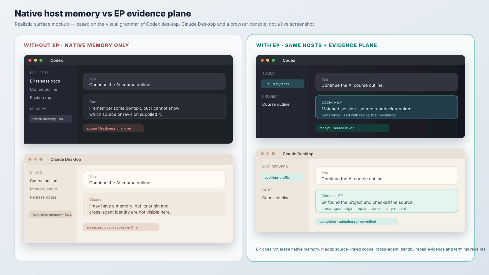
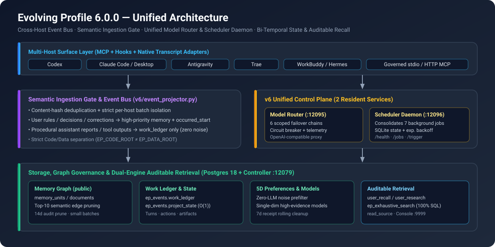
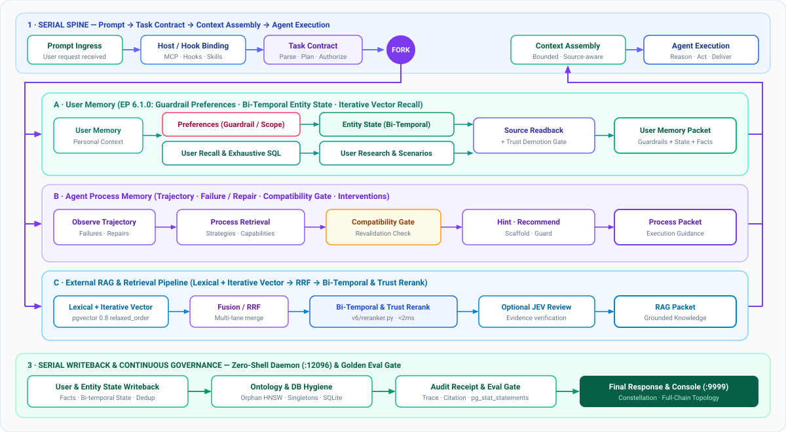
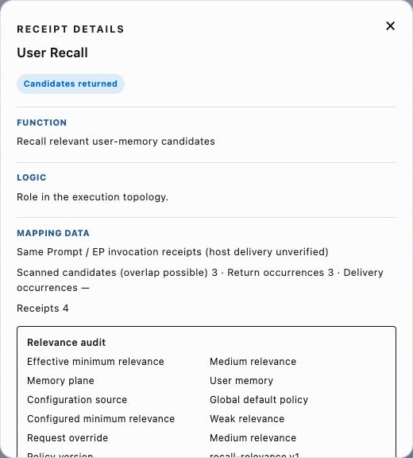
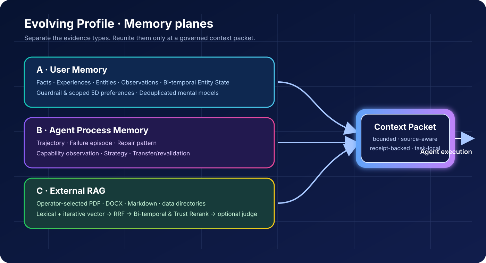
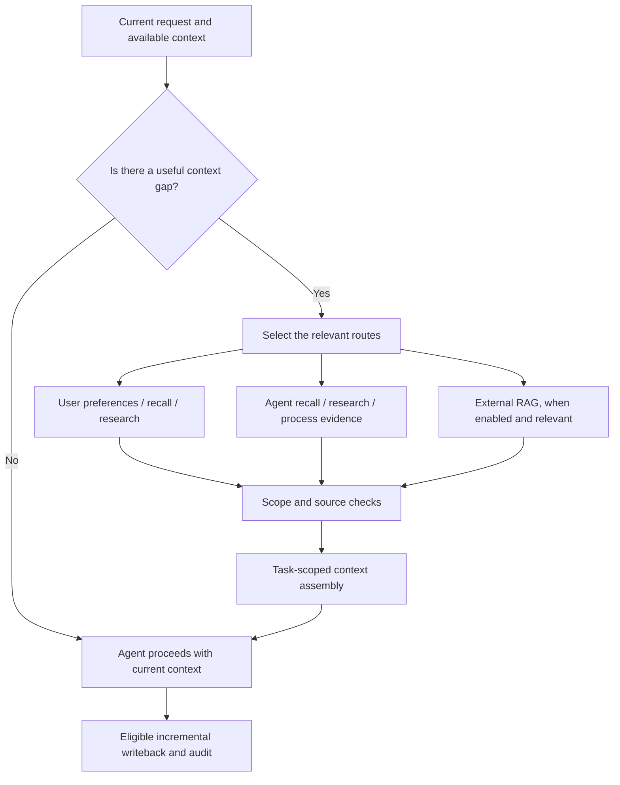

# Evolving Profile

[简体中文](README-中文.md)

<div align="center">

**Turn past conversations into personal context—and past work into reusable agent experience.**

Source-linked memory about you, how you work, and how your agent gets things done.

**Multi-dimensional evidence distillation · Five-dimensional preferences · Reusable agent experience · Observable execution**

[Quick start](#ep-quick-start) · [How it works](#ep-how-it-works) · [Agent installation](#ep-agent-setup) · [Release status](docs/RELEASE-LEDGER.md)

</div>

You have explained the project before. Your agent has solved a similar problem before.
Why do you still have to repeat the context—and watch it take the same detour?

**Evolving Profile (EP)** distills conversations and execution evidence into
**multi-dimensional personal memory and reusable agent experience**. It keeps
your facts, relationships, decisions and working preferences connected to their
sources, while separately organizing what the agent tried, where it failed,
how it recovered and which strategies have supporting verification.

The result is context for continuing work: an agent can find the right project,
adapt to how you prefer to collaborate, and consult relevant execution experience.
The console lets you inspect the extracted memory, correct preferences and trace
the evidence behind retrieval and delivery. Optional external documents remain
a separate knowledge source.

## Before and after EP

Codex and Claude already have native long-term memory in some surfaces. This comparison
does not pretend that the hosts start empty: it shows the difference between native host
memory alone and the same hosts connected to EP. Native memory can be stale, scoped to one
host, hard to attribute to a source or revision, inconsistent with a later correction, or
retrieved without any visible proof that the answer used it.

The examples below are **illustrative conversations**, written to show the kind of
continuity and evidence handling EP is designed to provide. They are not an accuracy
benchmark, and they do not promise that every answer will use every returned memory.

| Native Codex/Claude memory only | Codex/Claude + EP |
| --- | --- |
| **User:** “Continue the AI course outline for the School of Economics and Management.”<br>**Agent:** “Please resend the audience, the last version, your preferred structure and the previous conclusion.”<br><br>The user repeats context, while an old omission can be repeated. | **User:** “Continue the AI course outline for the School of Economics and Management.”<br>**Agent:** “I located the matching project session. I will preserve the leadership perspective, use the agreed causal-first structure, read back the source material where names or scope matter, and run a regression check before delivery.”<br><br>EP supplies scoped navigation and conditional preferences; the agent still verifies the source. |
| **User:** “The memory job failed again.”<br>**Agent:** “Retrying the same operation.”<br><br>A retry can hide a contract mismatch or lose the reason for failure. | **User:** “The memory job failed again.”<br>**Agent:** “The receipt shows a source/version contract mismatch. I will compare the current fingerprint, choose a bounded repair or an AI report, preserve the failed record, and verify the terminal job status before reporting success.”<br><br>EP keeps failure, repair and verification as separate evidence. |

The practical difference is a shorter path from request → relevant context → source check →
execution → verification. EP does not retrain the underlying model or turn an unverified
candidate into a fact.



The interface above is a realistic product walkthrough, not a captured production screen.
It uses the visual grammar of Codex desktop, Claude Desktop and an EP browser console so the
comparison is about the actual host boundary rather than an imaginary empty chat window.

### Why native memory alone can still fail

| Question | Native host memory | EP alongside the host |
| --- | --- | --- |
| Where did this come from? | The host may show a memory setting or a personalized answer without a source receipt. | EP links the candidate to a scoped Session, source revision and optional original-source readback. |
| Is it current? | A later correction can coexist with an older remembered statement. | EP retains conditions, superseding evidence and version/fingerprint checks before repair or publication. |
| Can Codex and Claude share it? | Each host may keep its own memory namespace and lifecycle. | EP records `origin_agent`, Bank scope and cross-agent lineage as separate evidence. |
| Did the agent really use it? | A memory being available does not prove it reached the prompt or changed the answer. | EP separates returned context, host delivery and answer adoption; unknown remains unknown. |
| What happens after failure? | Native memory usually does not expose a repair queue, failed attempt, or restore receipt. | EP keeps the failure, proposes bounded repair/AI report, preserves the original and verifies the terminal state. |

EP is therefore an evidence and recovery layer around native agent memory, not a claim that native
Codex or Claude memory does not exist or that EP removes every possible memory error.

EP's advantage is not a single “memory score”. It is the combination of a user-memory
plane, an agent-process plane and host adapters that keep their evidence connected. A
standalone native memory feature, Hindsight backend or AgentMemory MCP can each be useful;
the difference is whether the whole chain is visible and recoverable for the person using
Codex and Claude across projects.

## A realistic cross-host walkthrough

The following is a longer **illustrative walkthrough**, not a benchmark or a claim that
any competing product can never implement one of these actions. It shows the difference
between using each component by itself and using EP as the coordinating evidence layer.

### 1. The user resumes a real project in Claude Desktop

```text
Claude Desktop
You: Continue the AI course outline for the School of Economics and Management.

Native memory only
Claude: I remember an AI course outline, but I cannot tell whether it was the
      Tianjin Vocational University project or the Hebei University project.
      Please paste the audience and the last approved version.

Hindsight-only backend
Recall: 3 similar chunks returned.
       The chunks do not identify the active Session, the later correction,
       or whether the text was a draft or an approved version.

AgentMemory-only process store
Process hint: “Use a causal-first structure.”
             It does not prove which project source supplied that preference.

EP-connected Claude Desktop
EP user_scenario_summary: 1 matching project, 2 nearby candidates excluded.
EP user_preference: preserve leadership perspective; lead with the result;
                   explain the causal chain before listing implementation.
EP user_source_readback: approved scope and the latest correction located.
Claude: I found the matching project Session. I will keep the leadership angle,
        verify names and scope against the original source, then produce the
        outline and a regression checklist.
```

The visible benefit is not that EP “knows more words”. It keeps project identity,
conditions, corrections and source readback together, while excluding similar projects
that merely share an institution name.

### 2. The user moves from Claude Desktop to Codex

```text
Codex desktop
You: Turn that outline into the leadership briefing and keep the same decisions.

Without a shared evidence layer
Codex: I can use the current chat, but I do not have the Claude conversation's
        source boundary or the reason the earlier structure was selected.

With EP
EP origin_agent: claude-desktop → codex
EP lineage: same Bank, same project key, later stage of the same task
EP preference packet: result-first · causal explanation · visual acceptance check
EP source revision: approved-scope@r17
Codex: I am using the same project-scoped decisions. I will not merge the
       similar Tianjin project, and I will re-read the source before changing
       an amount, date, named institution or approved conclusion.
```

This is where EP differs from a host-local memory toggle: it carries the identity and
revision boundary between hosts and makes the handoff inspectable.

### 3. A real failure is repaired instead of hidden

```text
EP Console · Operations overview
Incident: mental-model refresh failed
Root cause: source/version contract mismatch
Original operation: retained and linked
Repair action: bounded AI diagnosis + source-fingerprint check

[Preview repair]
Model report: the failure came from an old source envelope; no original record
              will be deleted; the candidate update is limited to this model.

[Apply repair]
Status: applied → completed
Verification: source fingerprint matched; queue terminal state read back;
              previous error retained in attempt_errors; backup receipt present.

Native memory only: “memory unavailable” or a silent retry.
Hindsight-only: a useful memory of the error may be retrieved, but the host queue,
                repair plan, backup and final operation state are separate concerns.
AgentMemory-only: a repair strategy may be remembered, but not necessarily linked
                  to the user's source, current Bank or actual terminal receipt.
```

EP keeps the failed attempt instead of rewriting history. The user can see what failed,
what the model proposed, what was applied and what was actually verified.

### What the combination adds

| Layer | What a standalone memory component can provide | What EP adds around it |
| --- | --- | --- |
| Native Codex/Claude memory | Host-level personalization and remembered context | Shared Bank scope, source identity, cross-host lineage and delivery/adoption boundaries |
| Hindsight | A strong retain/recall/reflect memory backend when configured | Five-dimensional preferences, scenario navigation, source readback, host adapters and operational receipts |
| AgentMemory | Agent traces, strategies and process-memory candidates | Links process experience to user/project evidence, model/tool conditions, repair plans and revalidation |
| External RAG | Search over operator-selected documents | Keeps external documents separate from personal history and agent experience, with explicit source categories |
| EP integrated stack | — | User memory + agent experience + host lifecycle + repair + backup/restore + observable evidence in one workflow |

That is the claim the README should make: EP is difficult to replace with one memory
backend because it connects the planes and closes the loop from retrieval to source
verification, execution, repair and recovery. It is not a claim that Hindsight, AgentMemory
or native host memory are useless; EP makes them more useful by giving them scope and
operational evidence.



## See the workflow



A real console capture of an existing historical audit record, cropped to exclude
the private Prompt list. Historical source attribution is not a natural-user benchmark. Branches are
available routes, **not a claim that every route runs on every request**. Counts
describe the selected recorded invocation; they are not an accuracy benchmark or
proof that a final answer adopted the returned content.

<details>
<summary>Inspect a receipt, not just a diagram</summary>



Node details expose the evidence available for that step. No receipt, an observed
empty result, an excluded candidate and unknown host visibility are different states.

</details>

## What EP brings to your workflow

| Capability | Practical value |
| --- | --- |
| **Personal context with sources** | Organize facts, states, experiences, entities and relationships, with time and original evidence for checking earlier decisions. |
| **Five-dimensional preferences** | Adapt communication, learning, reasoning, collaboration and delivery to the task; inspect conditions, exceptions and cross-dimensional mental-model references. |
| **Agent experience that can be re-evaluated** | Connect trajectories and observations to failures, repairs, reusable strategy candidates, capability observations and migration/revalidation. |
| **Layered scenario navigation** | Locate the relevant Session and stage before expanding context or reading original evidence. |
| **Separate external knowledge** | Search your selected document collection without treating a PDF as your personal history or preference. |
| **Observable memory routes** | Diagnose whether a problem occurred during retrieval, admission, return, delivery or source readback. |
| **Modular controls** | Configure memory modules, providers, retrieval models, optional judges and budgets for the workflow you actually need. |

These capabilities provide structured evidence and reusable context; they do not
guarantee that every old memory is correct or every future task will improve.

## Maturity at a glance

**6.1.0 is the current release; platform-specific validation boundaries remain explicit.**

The 6.1.0 release builds on the unified v6 architecture with full cross-platform adaptive runtime & ontology governance:
- **Unified Control Plane & Zero-Shell Scheduling**: local OpenAI-compatible **Model Router** (`v6/model_router.py`, `:12095`, strict failover default + circuit breaker + telemetry) and resident pure-Python **Scheduler Daemon** (`v6/daemon.py`, `:12096`) managing 13 background jobs with zero `.zsh`/shell dependency across macOS, Windows, and Linux.
- **Cross-Platform Postgres 18 & pgvector 0.8 Auto-Tuner** (`v6/pg_autotune.py`): hardware-adaptive `shared_buffers`, `work_mem`, `maintenance_work_mem`, `effective_cache_size`, `max_wal_size`, `jit = off`, `autovacuum_vacuum_scale_factor = 0.05`, `idle_in_transaction_session_timeout = 60s`, `pg_stat_statements` slow-SQL profiling, full-DB `ANALYZE`, and automatic `pgvector >= 0.8` `hnsw.iterative_scan = relaxed_order`.
- **Bi-Temporal State & Ontology Hygiene**: generalized mutable **Entity State** ledger (`v6/entity_state.py`, `ep_events.entity_state` with `valid_from`/`valid_to`/`superseded_by`), IDF-weighted **Entity Graph** (`v6/entity_graph.py`), **Bi-Temporal & Trust Reranker** (`v6/reranker.py`), automated **Ontology & Preference Governance** (`v6/ontology_hygiene.py`: active model deduplication, `enforcement` guardrails + `scope_level` isolation, unconfirmed assistant experience soft-demotion, orphan HNSW index & singleton entity cleanup), **SQLite & Release Hygiene** (`v6/sqlite_hygiene.py`), and an automated **Golden Quality Gate** (`v6/eval_harness.py`).
- **Matched Web Console Visualization**: Preference Constellation highlights `hard_guardrail` vs `default_policy` / `soft_style` and `scope_level`, Memory Constellation dims soft-demoted entries while preserving traceability, and the Full-Chain Topology exposes **Entity State** and **Bi-temporal & Trust Rerank**.

EP is developed on top of [Hindsight](https://github.com/vectorize-io/hindsight); see [NOTICE.md](NOTICE.md). Full notes: [CHANGELOG-6.1.md](CHANGELOG-6.1.md) · [CHANGELOG-6.0.md](CHANGELOG-6.0.md) · Architecture: [docs/ARCHITECTURE-v6.md](docs/ARCHITECTURE-v6.md) · Earlier 5.1 notes: [CHANGELOG-5.1.md](CHANGELOG-5.1.md).

Product version comes from [VERSION](VERSION); channel/build metadata comes from
the checked [release manifest](config/release-manifest.json). The current 6.1.0
documentation and code are on `main` and the [`release/6.1.0` branch](https://github.com/gtkj/evolving-profile/tree/release/6.1.0)
(tag [`v6.1.0`](https://github.com/gtkj/evolving-profile/releases/tag/v6.1.0), mirrored on [`ccygod/evolving-profile`](https://github.com/ccygod/evolving-profile)).

| Area | Current evidence | Still needs validation |
| --- | --- | --- |
| User/agent memory, five-dimensional preferences, bi-temporal `entity_state`, scenario/source navigation and observable topology | Exercised end-to-end across **Codex, Claude Desktop, Claude Code CLI, Antigravity, and Trae** on macOS (`ep_events.work_ledger` multi-host turns verified) | Whole-history accuracy, universal answer benefit and every model/task combination |
| Host integrations management page | Implemented; real local Console clicks, Chinese/English, scroll and responsive checks | Native target-client acceptance for non-macOS clients |
| Governed stdio and optional authenticated HTTP | EP-side protocol/policy tests + live MCP reads/captures on Codex, Claude Desktop/CLI, Antigravity, and Trae; new profiles default to read-only | Remote/TLS operation and every lazy tool dependency branch |
| Claude Desktop, Claude Code CLI, Antigravity, Trae | Active multi-host adapters & Hook/MCP bridges feeding unified `work_ledger`, `entity_state`, and memory banks on macOS | Windows/Linux native lifecycle parity across all client versions |
| Hermes, WorkBuddy and Doubao Work | Capability profiles, discovery, previews, guidance and diagnostics prepared | Native task/session evidence; no equal-validation claim with Codex/Claude/Antigravity |
| Windows native / WSL / remote | Zero-shell pure-Python `v6/daemon.py` + `v6/pg_autotune.py` + native `scripts/install.ps1` / `scripts/install.py` (`uv` auto-provisions Python 3.11+) | Full end-to-end native Windows acceptance run on clean machines |
| External RAG / JEV / local models | Existing optional modules and configuration | Operator's actual files, keys, models, index compatibility and measured benefit |

“Detected”, “configured”, “EP protocol verified”, “host received” and “answer
adopted” are different claims. Missing evidence stays unknown, not zero or success.
See [candidate scope and acceptance](docs/RELEASE-NOTES-5.1.4.md).

## Personalization beyond a list of likes

EP extracts preferences across **five dimensions**, so personalization can affect
how a task is understood, discussed, executed and checked.

| Dimension | What it can capture | Illustrative preference |
| --- | --- | --- |
| **Communication & presentation** | Wording, tone, structure and visual presentation | “For status updates, lead with the result and then give the evidence.” |
| **Learning & understanding** | Explanation order, examples and learning methods | “Introduce a concrete example before the abstract mechanism.” |
| **Analysis & decision-making** | Evidence standards, alternatives and decision criteria | “Compare the tradeoffs and say which option you recommend.” |
| **Execution & collaboration** | Initiative, task scope, coordination and checkpoints | “Continue within the agreed scope; ask when the scope changes.” |
| **Quality & delivery** | Verification, acceptance criteria and deliverable expectations | “Render the document and inspect its pages before delivery.” |

These are examples, not installed defaults. An extracted preference can retain
its scope, applicability, exceptions, supporting quotes, review status and
superseding corrections. The console supports manual correction of its text and
conditions. **Fusion mental models** connect reviewed preferences across dimensions
to offer a broader reference for how someone works; they remain traceable,
conditional interpretations rather than a fixed personality assessment.

For the complete memory taxonomy, lifecycle and source-to-implementation map,
see [What EP can remember](docs/MEMORY-CAPABILITIES.md).

## Three memory planes, different responsibilities



**User memory** holds facts, experiences, entities/relations, observations,
conditional preferences, mental-model references and scenario navigation.
A preference retains its conditions and exceptions; a project-local instruction
should not silently become a permanent global rule.

**Agent process memory** follows what the agent tried, where it failed, how it
repaired the problem and what verification was observed. It organizes failures,
repair patterns, strategies, capability observations and transfer/revalidation.
Experience remains scoped to tasks, tools, time and available evidence; it is
not automatically installed as a Skill or a permanent command for newer models.
This is adaptation through stored evidence, selection and revalidation; EP does
not retrain the underlying model's weights.

**External RAG** is for an operator-selected collection of PDF, Word, Markdown
and other supported files. It offers lexical/vector retrieval, reciprocal-rank
fusion (RRF), optional model reranking and index compatibility/rebuild controls.
It is optional—not a second index that EP's internal memory must use.

<a id="ep-how-it-works"></a>

## How it works



The agent can combine routes when a task needs both personal context and
execution experience. Explicit source restrictions still take priority.

### Navigate first, expand when needed

Scenario Summary has **three tiers: compact → standard → full**. It locates the
conversation, stage, constraints and later corrections; it is not a substitute
for exact original wording.

When the summaries are insufficient, use the bounded original Session/Project
reading route. Use source readback for consequential names, amounts, versions,
negations and conflicts. The right reader depends on the available source
locator; a local transcript path is not automatically a Bank `read_source` ID.

### Keep evidence states distinct

```text
discovered ≠ returned ≠ delivery observed ≠ source read ≠ answer adoption confirmed
```

This separation makes weak or uncertain evidence usable as navigation without
turning it into a verified fact. Relevance controls can retain weak background
while excluding unrelated content; relevance is not a truth score.

## Typical uses

**An illustrative project handoff:** a proposal changes from an early draft to an
approved scope. EP can help locate the right Session, the later correction and
the original wording, while separately consulting preferences about how to
present the final document. A shared organization name alone is insufficient
to merge two projects.

**An illustrative repair:** an agent previously fixed a rendering failure.
Process memory can preserve the attempt, failure, repair and verification, then
offer a relevant strategy candidate for another task. A changed model or toolchain
still needs an applicability check; an old success is not a universal recipe.

- **Resume a project:** locate earlier decisions, constraints and corrections
  without merging unrelated projects from the same organization.
- **Adapt collaboration:** consult conditional preferences for the current task,
  rather than inject every preference into every answer.
- **Reuse execution experience:** retrieve earlier debugging or production
  lessons, then check whether their prerequisites still apply.
- **Work with outside documents:** compare your own history with a supplied
  document while preserving the two source categories.
- **Explain an apparent memory failure:** inspect the actual route and receipt
  instead of guessing that “the model forgot.”

## Configure behavior and cost

The web console exposes user/agent memory modules, Provider/Fallback,
Embedding/Rerank models, external RAG, Scenario Summary, JEV, backup and audit
settings. Recording, retrieval and context use have distinct responsibilities;
module switches do not mean deleting the stored records.

- Use local or online retrieval models where supported; verify the actual model
  path/service and index signature before treating it as ready.
- Enable external RAG only for the collections you want searched.
- **JEV is optional:** it can assist selected routing/evidence-review stages;
  it does not replace the retriever or write facts. Its configured rule-based
  fallback and unknown/error states remain visible.
- High-risk judgment is a separate opt-in setting, not permission to override
  the host's existing authority and source-verification boundaries.
- Background extraction and optional online judgment can consume provider
  tokens. Local models have their own memory/startup cost. Use module controls,
  bounded expansion, pagination and budgets rather than assume memory is free.

Experimental whole-history model trials are not enabled by the installer.
Existing historical records may remain pending, protected or unknown; those
statuses are not erased merely to make a dashboard green.

<a id="ep-quick-start"></a>

## Quick start

**Start here:** [complete backend/web deployment](docs/DEPLOYMENT.md) →
[choose your host](docs/HOST-SETUP.md) → [copy its Agent request](docs/AGENT-SETUP.md).
**Installing this candidate?** Start with [candidate setup](docs/CANDIDATE-SETUP.md).
**Agent reading this repository:** installation alone is not usage; read
[the Agent operating guide](docs/AGENT-USAGE.md) before choosing memory tools.
This checkout is the **6.1.0** release line. The product version is read from
[VERSION](VERSION), and the current documentation branch is `release/6.1.0`
(mirrored on `main`); older `v5.1.x` tags are historical archives only.

### First-run acceptance path

For a complete local run, treat these as separate gates:

1. **Build:** run the installer and confirm it reports `EP 6.1.0` from `VERSION`.
2. **API:** start port `8888` and require `curl --fail http://127.0.0.1:8888/health`.
3. **Controller:** start port `12079` and require `curl --fail http://127.0.0.1:12079/v1/status`.
4. **Console:** start port `9999`, open the selected language route, create or select your own Bank, and click through the health/configuration pages.
5. **Host:** register exactly one MCP/Hook entry for the actual host, then make one real read and one permitted capture task.
6. **Recovery:** inspect the receipt, queue terminal state, local backup checksum and (if enabled) cloud readback separately.

A green Console page alone proves none of the later gates. The full commands,
macOS scheduler, cloud-backup boundary, upgrade and rollback steps are in
[Deployment](docs/DEPLOYMENT.md).

### Requirements

- Python **3.11+**, `uv`, Node.js **20.9+**, npm and Git.
- PostgreSQL with pgvector for the full API, or the explicitly installed
  `embedded-db` extra for a supported embedded route.
- A configured chat provider and a working embedding route; a chat-only plan
  does not necessarily include embeddings.
- macOS was exercised locally. Linux is a target with platform prerequisites;
  Windows-native installation is not certified here.

### 1. Install and build

**Cross-platform (macOS / Linux / Windows PowerShell — recommended; `uv` auto-provisions Python 3.11+ even if system Python is older):**

```bash
git clone --branch release/6.1.0 --single-branch https://github.com/gtkj/evolving-profile.git
cd evolving-profile
uv run --python 3.11 scripts/install.py --mode local --no-launch
```

On **Windows PowerShell**, you can also run:

```powershell
.\scripts\install.ps1 -NoLaunch
```

Legacy Bash wrapper (`./scripts/install-ep51.sh --mode local --no-launch`) remains available for macOS/Linux/WSL.
Before running, confirm `VERSION` is `6.1.0` and record the commit shown by `git rev-parse HEAD`.

This runs preflight and a release text-source scan, installs base dependencies,
builds the SDK **before** the Console and writes a local launch manifest.
It creates `.env` only when absent. **It does not start services or register MCP/Hook.**

Use `--dry-run` for zero-write inspection. Use `--skip-deps` only when this
checkout's dependencies already exist—not for the first install.

### 2. Configure your own services

Fill the generated local `.env` using [API configuration](api/README.md).
Prepare your database and embedding service. Base dependencies do not include
embedded PostgreSQL or local ML; select the required extras explicitly.
Use the same Bank ID in the API, Controller and host configuration. Changing a
Console selector alone does not configure a host's memory namespace.

No production Bank, private transcript, credentials or local model weights are
provided. JEV, cloud backup and external RAG are not enabled by installation.

### 3. Start API and Console

From the repository root, in separate terminals:

```bash
uv run --project api --env-file .env evolving-profile-api --host 127.0.0.1 --port 8888 --workers 1
```

```bash
node --env-file=.env console/bin/cli.js --hostname 127.0.0.1 --port 9999 --api-url http://127.0.0.1:8888
```

Open [the local Console](http://127.0.0.1:9999). Create your own Bank and verify
health, real page interactions and the chosen model route.
See [complete setup, upgrade and rollback](docs/LOCAL-SETUP.md).

For host tools also start the **QueryController**, using the fresh-install
contract/policy and exact command in [deployment step4](docs/DEPLOYMENT.md#4-start-backend-and-web-ui).
The copyable route uses `personal-memory`; the current stdio adapter does not
switch Banks merely because `EP_BANK_ID` or a Console selector changes.

**API/Console startup is not full host integration.** Controller, Hook, Guidance
and background workers have separate setup and readiness requirements. An API
HTTP MCP handshake does not certify host `user_recall`, `agent_research` or
context delivery. Do not expose local ports publicly without access control.

<a id="ep-agent-setup"></a>

## Let your agent set it up

Pick the actual host below. Paste the sentence together with the linked full
request when you want the complete checklist; terminal/browser permission and
your own credentials are still required.

| Agent surface | One-sentence installation request |
| --- | --- |
| **Codex desktop / CLI** | Use my supplied EP candidate, read its deployment and Agent-use guides, start my backend/UI, register EP once and verify actual reads and permitted automatic capture. |
| **Claude Code CLI** | Follow EP's deployment and Claude CLI guides, start my local backend/UI, register its stdio MCP with `claude mcp add` and verify a real read without claiming untested automatic recording. |
| **Claude Code desktop — local Code tab** | Follow EP's local Code-tab guide, reuse the intended MCP definition without duplicates, start backend/UI and verify tools in this actual desktop session. |
| **Claude Desktop — ordinary Chat/Cowork** | Connect this Chat to my already running EP with the local MCP recipe; if terminal/browser tools are absent, give the separate CLI/Code backend request rather than claim system deployment. |
| **Hermes** | Inspect this Hermes installation's real MCP/API capabilities, use the supplied candidate and operating guide, and verify explicit reads before claiming automatic lifecycle. |
| **WorkBuddy** | Prepare host-specific configuration first; register only if the installed client and my authorization are present, then follow the Agent operating guide. |
| **Doubao Work** | Review the actual plugin setup, select it for this task and follow the operating guide; do not claim a Skill guarantees every-turn execution. |

Repository provenance: `https://github.com/gtkj/evolving-profile` (mirror: `https://github.com/ccygod/evolving-profile`).
Use `main` or the current `release/6.1.0` branch (or a named verified archive); do not silently
substitute older `v5.1.x` tags without comparing their commit and manifest.
**[Copy the full per-host prompts, including Hermes](docs/AGENT-SETUP.md).**
They specify backup/merge, absolute paths, real health/UI/tool/capture acceptance,
effective configuration, optional features and safe stopping/rollback.

For day-to-day use after connection, give the Agent [AGENT-USAGE.md](docs/AGENT-USAGE.md).
It covers tool routing, current-prompt binding, source readback, failure recovery,
no-Hook behavior and host-specific limits. The machine-readable companion is
[agent-usage.v1.json](config/agent-usage.v1.json); it is advisory, not a permission grant.

## Host compatibility

**Claude Desktop is not Claude Code.** `Claude Desktop` means the ordinary Chat/Cowork surface; `Claude Code` means the CLI or the separate desktop Code workspace. They have different settings, lifecycle hooks and evidence boundaries.

| Host | Current position | Do not assume |
| --- | --- | --- |
| **Codex** | Exercised end-to-end across MCP/Hook, memory routes, scenarios, and receipts | Every black-box answer has an adoption receipt |
| **Claude Code CLI** | Exercised with stdio MCP + host-adaptive Hook bridge + live `work_ledger` capture | Native Windows CLI acceptance |
| **Claude Desktop — Cowork / local agent sessions** | Exercised end-to-end on macOS: Hook plugin + bridge, `origin_agent=claude-desktop`, Scenario Summaries, health check | Windows/Linux or other Desktop versions |
| **Antigravity** | Exercised end-to-end with governed MCP + native transcript adapter (`events/adapters/antigravity.py`) + `work_ledger` turns | Native Windows path regression |
| **Trae** | Exercised with native transcript adapter + `work_ledger` turns | Automatic Hook injection |
| **Hermes** | Shared memory services and compatible MCP/API contracts can be reused | Identical capability probes, receipts or onboarding |

### Claude Desktop and Claude CLI (new in 5.1.3)

One EP Bank can now be fed and read by **Codex, Claude Desktop and Claude CLI at the same time**, and the integration works out which host is calling by itself.
Full guide: **[docs/host-integrations/CLAUDE-DESKTOP-CLI.md](docs/host-integrations/CLAUDE-DESKTOP-CLI.md)** ([中文](docs/host-integrations/CLAUDE-DESKTOP-CLI-中文.md)).

- **Host-adaptive bridge** (`claude-code/hook_bridge_desktop.py`): one entry point for SessionStart, UserPromptSubmit, PreToolUse, PostToolUse, PreCompact and Stop.
  It detects Claude Desktop / Claude CLI / generic Claude Code (or an explicit `EP_HOST` override), tags every captured record with `origin_agent`, and never blocks Claude (always exit 0).
- **Only human-visible dialogue is retained.** Tool results, thinking, images, sidechains and system reminders are dropped, fixing the old behaviour where file dumps were stored as things *you* said.
- **Desktop chats reach Scenario Summaries**: a Codex-format rollout is written into EP's own `claude-code/rollouts/` (never `~/.codex`) after a settle period, so the background summariser is not invalidated mid-run.
- **Fact-extraction quote repair**: deterministic, fail-closed repair of almost-verbatim `source_quote`s, so fewer batches end in quarantine while the "exact substring of the claimed author's message" guarantee is kept. Kill switch `EVOLVING_PROFILE_API_QUOTE_REPAIR=0`.
- **One command to install, one to check**: `zsh claude-code/install.sh [--desktop-plugin]` (dry-run, backups, uninstall supported) and `python3 claude-code/compat/ep_desktop_health.py` (read-only OK/WARN/FAIL for every link, including read/write embedding-model consistency).
- Codex is untouched: `~/.codex/*` and `codex.json` are never read or written, and existing Codex data keeps `origin_agent=codex`.

**Evidence and limits, stated plainly:** developed and exercised on one macOS machine with Claude Desktop 3P. The CLI path was verified through the real bridge with simulated host markers, not in a live CLI session.
Hook activity proves context delivery, not that an answer used it. Desktop needs one `sudo` for the system plugin directory. Details and every known limit are in the guide and in [RELEASE-NOTES-5.1.3](docs/RELEASE-NOTES-5.1.3.md).

The new [host-preparation profiles and management tools](docs/host-integrations/README.md)
also cover WorkBuddy, Doubao Work and generic MCP clients. Profiles are implemented,
not merely a future roadmap; full target-host lifecycle certification is still pending.
See the [generated capability matrix](docs/host-integrations/MATRIX.md). It records
documented capabilities, not a native acceptance score. No equal-validation claim is made.

For recommended modules, relevance, Provider/fallback, model/index matching,
RAG/JEV and backup settings, read [web configuration guidance](docs/DEPLOYMENT.md#5-configuration-recommendations-in-the-web-ui).
**A saved UI Provider profile and the manual API's `.env` are not automatically
the same configuration.** Verify the effective profile before claiming changes applied.

## Reliability, privacy and limits

- Memory candidates, scenario summaries and process patterns are not verified
  external facts. Assistant completion statements retain their evidence level.
- Tool invocation and returned content do not prove final-answer adoption.
- UI language selection includes English and Chinese; backend-generated
  diagnostics and user-authored source text are not guaranteed fully translated.
- Source-text scanning is not a binary-asset audit or dependency-risk guarantee.
- All-history semantic accuracy and answer benefit are not globally certified.
- Always use the documented `--hostname 127.0.0.1`; the legacy bare Console CLI still defaults
  to all interfaces. This candidate does not silently change that default or authorize public exposure.

Product version: [`VERSION`](VERSION). Current release status, actual checks,
dependency risks and known limits belong in the [candidate notes](docs/RELEASE-NOTES-5.1.4.md)
and [release ledger](docs/RELEASE-LEDGER.md), not in a permanently duplicated badge.
See the [dependency risk disposition](docs/DEPENDENCY-RISKS.md) for the distinct
production-classified and full-workspace audit results and retained RC risks.

## Authorship, source and documentation

EP distribution author/maintainer: **CCY**. The
[primary repository](https://github.com/gtkj/evolving-profile) and
[personal mirror](https://github.com/ccygod/evolving-profile) are
two channels for the same release line, not unrelated implementations.
Preserve [NOTICE](NOTICE.md) and the applicable upstream licenses. Repository
ownership, Git commit identity and upstream acknowledgment remain distinct.

- [中文介绍](README-中文.md)
- [Local setup and rollback](docs/LOCAL-SETUP.md) · [API configuration](api/README.md)
- [Deployment](docs/DEPLOYMENT.md) · [Host setup](docs/HOST-SETUP.md) · [Agent requests](docs/AGENT-SETUP.md)
- [Agent operating guide](docs/AGENT-USAGE.md) · [Candidate setup](docs/CANDIDATE-SETUP.md)
- [Changelog (6.1)](CHANGELOG-6.1.md) · [Changelog (6.0)](CHANGELOG-6.0.md) · [Architecture (v6)](docs/ARCHITECTURE-v6.md) · [Earlier 5.1 notes](CHANGELOG-5.1.md)
- [Source-of-truth map](config/source-of-truth.json) · [Security policy](SECURITY.md)

## Built on Hindsight

**Evolving Profile is developed on top of [Hindsight](https://github.com/vectorize-io/hindsight).**
Hindsight provides the upstream memory foundation; EP builds its user/agent
memory organization, conditional preferences, host integration and observable
control plane on that foundation. Credit for the upstream work belongs to the
Hindsight project and its contributors. Preserve [NOTICE](NOTICE.md) and all
applicable upstream licenses and notices when using or redistributing the code.
